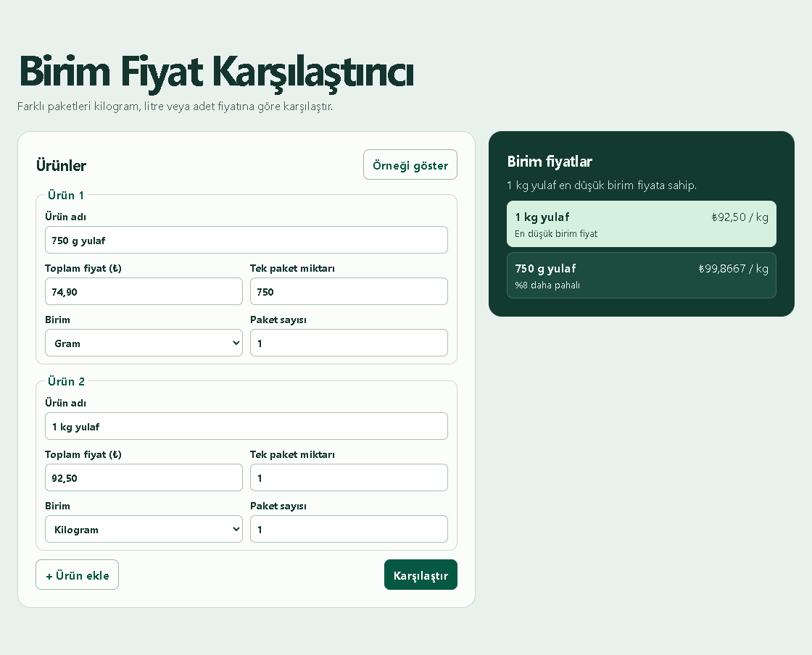

# Birim Fiyat Karşılaştırıcı

Paket boyutları ve çoklu paketler farklı olduğunda ürünleri kilogram, litre veya adet fiyatına göre sırala. Araç en düşük birim fiyatı ve diğer seçeneklerin yüzde farkını gösterir.

## Kullanım

Depoyu indirip `index.html` dosyasını tarayıcıda aç. Ağ bağlantısı ve kurulum gerekmez.

1. Her ürün için kasada ödeyeceğin toplam fiyatı gir.
2. Bir paketin miktarını ve birimini seç. Örneğin 6 × 330 mL için miktara **330**, birime **Mililitre**, paket sayısına **6** yaz.
3. **Karşılaştır** düğmesine bas. Ürünlerin aynı ölçü türünde olması gerekir. Gram ve kilogram birlikte kullanılabilir. Litre ve mililitre de birlikte kullanılabilir.

Ondalık ayırıcı olarak virgül veya nokta kullanabilirsin. Binlik ayırıcıyı kaldır. Hesap birim fiyatı sıralarken tam sayısal değeri kullanır ve yalnızca gösterimde yuvarlar. Ücretsiz ürün varsa yüzde fark yerine daha yüksek birim fiyat bilgisi gösterilir.

## Test

Node.js 22 veya üzeriyle `node --test` çalıştır. Testler birim dönüşümünü, çoklu paketleri, eşit fiyatları ve hatalı girdileri kapsar.
